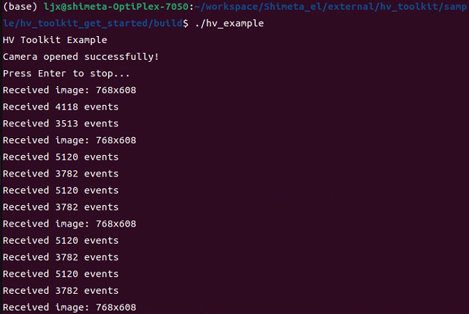
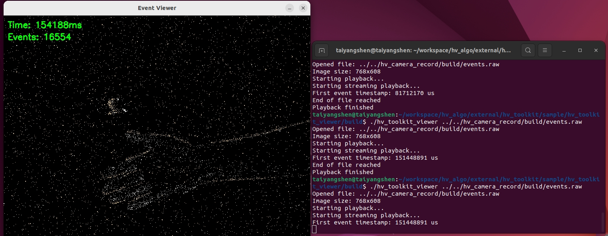
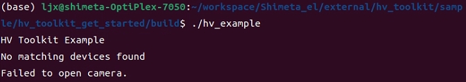
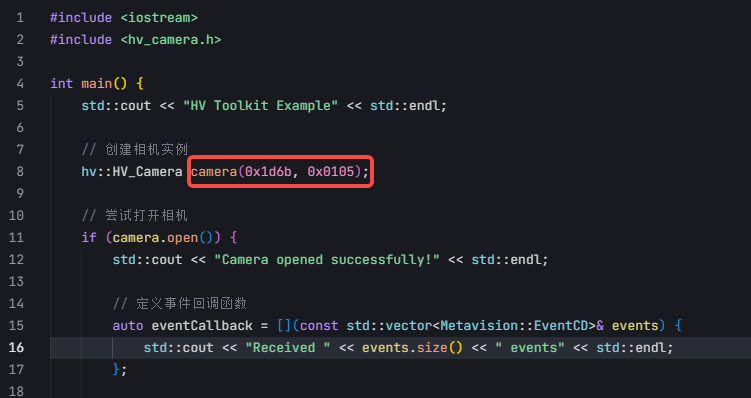

# HV Toolkit

**语言**: **中文** | [English](README_EN.md)

HV Toolkit（ShiMetaPi Hybrid Vision Toolkit）**v2.0** 是面向事件相机（DVS/EVS）的高性能 C++17 SDK，统一采集事件数据流（EVS）与图像数据流（APS），自带零第三方依赖的 EVT2/EVT3 编解码。v2.0 完成核心重写：**USB / MIPI / Ethernet 三后端统一为同一套 `Camera` API**，公有 API 表面不再依赖任何第三方事件 SDK。

> 本仓库为**预编译二进制发布版**（核心以 `.so` 闭源交付，仅公开头文件与示例源码）。
> `lib/x86_64/` 为 x86_64 Linux 库（USB + Ethernet 后端），`lib/s100/` 与 `lib/x5/` 为 aarch64 库（MIPI + Ethernet 后端），`lib/openEuler/` 为 openEuler RK3588 ARM64 库（USB + Ethernet 后端）。

## ✨ v2.0 特性

- **三后端统一**：USB（libusb）/ MIPI（RDK，仅 ARM）/ Ethernet（POSIX TCP）—— 同一套 `Camera` 接口，后端由 `DeviceConfig.backend` 选择。
- **双回调 + 同步拉取**：`SetFrameCallback` / `SetEventCallback` / `SetImageCallback` 异步回调，`GetFrame` 同步拉取。
- **自洽编解码**：EVT2 / EVT3 / MIPI RAW8 的 `Encoder`/`Decoder`，零外部 SDK。
- **IO 读写**：`EventReader` / `EventWriter` / `HybridWriter` / `HybridReader`（RAW 文件读写 + EVS/APS 混合录制/回放）。
- **Python 绑定**（可选）：单一 `hv_toolkit` 模块（pybind11），x86_64 预编译（Python 3.10）。
- **MIPI 帧率档运行时选择**：`DeviceConfig.evs_fps`（120/240/300/500/750/1000，Init 时生效，无需重编库）。
- **零第三方事件 SDK 依赖**：公有表面已与旧版第三方事件 SDK 完全解耦。

### 2026-11 APX014 协议更新与升级

- x86_64、S100、X5 配套库与公共头文件一起更新；核心仍以闭源 `.so` 交付。
- APX014 EVS 使用 40B DVS1 包头与 EVT2 负载，APS 使用 80B 帧头与 Gray8 640×1024。旧 APX014 子帧固件和旧 1280×1024 录像不受当前解码器支持；APX003 RAW8 路径保留。
- `HybridWriter::open()` 增加像素格式参数，`HybridReader` 增加 `apsFormat()`。请配套更新头文件和库，删除旧构建目录后重新编译应用，不要混用旧 `.so.2`；SONAME 未变不代表 ABI 兼容。
- x86_64 Python 3.10 模块同步重编译。Python 可采集 APX014 原始数据，但尚未导出 `Evs014PacketDecoder`；新协议解码示例见 C++ `viewer` / `ts_sync`。

## 📋 技术规格

### 支持设备（事件相机参数）

| 传感器 | EVS 分辨率 | APS 分辨率 | 备注 |
| --- | --- | --- | --- |
| **APX003** | 768×608（子采样：384×304） | 768×608（NV12） | |
| **APX014** | 640×1024（DVS1 / EVT2 包流） | 640×1024（Gray8） | 事件流 600fps |

- **双传感器自动识别**：USB 后端 `Init` 时按 **APS 首帧传输长度**探测档位（700,424B→APX003；655,440B→APX014），无需任何配置；识别结果打印 `[usb] sensor=APX003` / `[usb] sensor=APX014`，读长与图像尺寸随之自动切换。
- **数据传输**：USB 3.0（USB 后端）/ MIPI-CSI（MIPI 后端）/ TCP（Ethernet 后端）
- **事件格式**：EVT2 / EVT3（兼容 Prophesee EventCD 语义）


## 🔧 依赖

| 依赖 | 用途 | 适用平台 |
| --- | --- | --- |
| **libusb-1.0**（`libusb-1.0-0`） | USB 后端运行库 | x86_64、openEuler |
| **aarch64 交叉工具链**（`g++-aarch64-linux-gnu`） | ARM64 交叉编译示例 | s100、x5、openEuler（交叉编时） |
| **openEuler 开发 sysroot** | 目标 libc/libstdc++、libusb 头文件、库及 pkg-config 元数据 | openEuler（交叉编时） |
| **OpenCV** | `ts_sync` / `player` / `live_record_display` 示例（交叉编用仓库自带 `third_party/aarch64_opencv`） | 示例可选 |

> v2.0 **不再依赖**第三方事件 SDK —— 编解码为独立 clean-room 实现。OpenCV 仅在示例可视化中用到，非核心依赖。

## 🚀 快速开始

### 系统要求

- **C++ 标准**：C++17 或更高
- **CMake**：3.16+
- **操作系统**：Linux —— x86_64（USB + Ethernet 后端）；aarch64/S100 / X5（MIPI + Ethernet 后端）；openEuler RK3588 ARM64（USB + Ethernet 后端）

### 构建

预编译库随仓库分发，无需编译 SDK 本体；构建只编译示例（链接 `lib/<arch>` 的库），CMake 按目标架构自动选择。

#### x86_64（USB）

前置：安装依赖

```bash
sudo apt-get update
sudo apt-get install build-essential cmake libusb-1.0-0 libopencv-dev
```

构建：

```bash
cd shimetapi_Hybrid_vision_toolkit
./run.sh build                  # = cmake 配置 + 编译（默认本机架构）
```

也可直接用 cmake（等价）：

```bash
cmake -B out/x86_64/build -S .      # 构建目录 out/<arch>/build（与 run.sh 一致）
cmake --build out/x86_64/build -j    # 编出最多 9 个示例可执行文件
```

验证产物：

```bash
ls out/x86_64/build/libshimetapi_*.so                        # 构建时自动捆绑的 4 个库
ls out/x86_64/build/samples/cpp/get_started/hv_sample_get_started  # 示例可执行文件
```

#### S100（ARM MIPI，交叉编译）

前置：下载 + 解压 S100 工具链到 /opt/

```bash
curl -fO http://archive.d-robotics.cc/toolchain/arm-gnu-toolchain-11.3.rel1-x86_64-aarch64-none-linux-gnu.tar.xz
sudo tar -xvf arm-gnu-toolchain-11.3.rel1-x86_64-aarch64-none-linux-gnu.tar.xz -C /opt
```

加入 PATH

```bash
export PATH=$PATH:/opt/arm-gnu-toolchain-11.3.rel1-x86_64-aarch64-none-linux-gnu/bin
```

S100_SDK仓库地址：https://github.com/ShiMetaPi/evs_device_vendor_sdk.git
拉取仓库后，设 S100 sysroot（板级库路径）

```bash
export S100_SYSROOT=evs_device_vendor_sdk/source/hobot-multimedia/debian/usr
```

构建：

```bash
./run.sh build s100    # 工具链文件自动注入（toolchains/toolchain-aarch64-linux-gnu.cmake）
                        # 也可 -DCMAKE_TOOLCHAIN_FILE=<你的-toolchain.cmake> 覆盖
```

验证产物：

```bash
ls out/s100/build/libshimetapi_*.so
file out/s100/build/samples/cpp/get_started/hv_sample_get_started  # 应为 ELF aarch64
# OpenCV 类样例（player / live_record_display）用 third_party/ 自带 aarch64 OpenCV，7/7 全编
```

#### X5（ARM MIPI，交叉编译）

X5 平台预编译库在 `lib/x5/`（aarch64）。前置：

```bash
# 1) aarch64 交叉工具链（同 S100 步骤，apt 装 g++-aarch64-linux-gnu 或 Arm GNU 11.3）
sudo apt-get install g++-aarch64-linux-gnu            # Ubuntu/Debian 系统编译器

# 2) X5 SDK 源码树（hobot-spdev/hobot-multimedia/hobot-multimedia-samples/hobot-camera）
#    默认期望 ../x5_sdk/RDK_X5（相对 toolkit 根目录），也可设 X5_SDK_ROOT 指向其他位置
git clone <X5_SDK_REPO> /path/to/RDK_X5
export X5_SDK_ROOT=/path/to/RDK_X5
```

构建：

```bash
./run.sh build x5      # aarch64 交叉；工具链与 SDK 已就绪即可
```

> `./run.sh` 自动探测 `../x5_sdk/RDK_X5`；缺失 X5_SDK_ROOT 时显式导出 `X5_SDK_ROOT=<path>`。
> 也可用 `-DCMAKE_TOOLCHAIN_FILE=<你的-toolchain.cmake>` 覆盖工具链。

产物布局同 s100：

```bash
ls out/x5/build/libshimetapi_*.so                                                # 预编译 4 个库已捆绑
file out/x5/build/samples/cpp/get_started/hv_sample_get_started                  # 应为 ELF aarch64
# OpenCV 类样例（player / live_record_display）用 third_party/ 自带 aarch64 OpenCV，7/7 全编
```

#### openEuler（RK3588 ARM64 USB，交叉编译）

openEuler 平台预编译库位于 `lib/openEuler/`，使用 USB + Ethernet 后端。
当前 APX014BA USB 录制流程已在 RK3588 openEuler 板卡验证；不依赖 S100/X5 的 MIPI/RDK 库。
本仓库仅编译示例并链接预编译库，无需重编 openEuler 系统固件或摄像头固件。

前置：使用上文 S100 步骤安装的 Arm GNU 11.3 工具链，并准备与板卡运行环境匹配的
openEuler **开发 sysroot**（含 libc、libstdc++、libusb 的头文件、库及 `.pc` 文件）。
Ubuntu 主机还需安装 `cmake` 和 `pkg-config`：

```bash
sudo apt-get install build-essential cmake pkg-config
export OPENEULER_TOOLCHAIN_PREFIX=/opt/arm-gnu-toolchain-11.3.rel1-x86_64-aarch64-none-linux-gnu/bin/aarch64-none-linux-gnu
export OPENEULER_SYSROOT=/path/to/openEuler-development-sysroot
```

`OPENEULER_TOOLCHAIN_PREFIX` 不带末尾的 `-`；sysroot 应包含 `usr/include/libusb-1.0`
及目标 libusb 库。请替换上面的 sysroot 路径，不要使用 Ubuntu 主机的库目录。

构建：

```bash
BUILD_JOBS=4 ./run.sh samples openEuler   # 配置、编译并列出示例产物
# 或 ./run.sh build openEuler
sha256sum -c SHA256SUMS                  # 校验随仓库发布的预编译库
```

验证产物：

```bash
ls build_release_openEuler/libshimetapi_*.so
file build_release_openEuler/samples/cpp/record_openEuler/hv_sample_record_openEuler
# 应为 ELF 64-bit ARM aarch64
```

产物目录固定为 `build_release_openEuler/`，编译 `get_started`、`callback`、`record`、
`record_openEuler`、`viewer`、`bench_hw` 六个示例。GUI 示例默认关闭，
`fps_control`、`ts_sync` 不在该平台编译；离线可视化在 Ubuntu 主机运行。
openEuler 必须显式指定，通用 ARM64 自动选择仍为 S100。
更换工具链或 sysroot 后，先重命名旧构建目录，再重新配置，避免复用旧路径缓存。
更多配置见 [openEuler 工具链说明](toolchains/openEuler/README.md)。

在自己的工程中链接（CMake）：

```cmake
# 把本仓库作为子目录，或 install 后使用
add_subdirectory(shimetapi_Hybrid_vision_toolkit)
target_link_libraries(your_app PRIVATE
HVToolkit::shimetapi_hv HVToolkit::shimetapi_codec HVToolkit::shimetapi_io)
```

安装到系统（头文件 + 当前架构的库）：

```bash
./run.sh install x86_64                          # 默认 /usr/local（需 sudo）
./run.sh install x86_64 /your/prefix             # 自定义 prefix
```

#### 查看支持的架构

```bash
./run.sh --list
# ARCH    STATUS        PREBUILT LIBS
# x86_64   ready         .../lib/x86_64
# s100     ready         .../lib/s100
# x5       ready         .../lib/x5
# openEuler ready        .../lib/openEuler
```

### 运行示例程序

x86_64、S100、X5 构建产物在 `out/<arch>/build/samples/cpp/<name>/hv_sample_<name>`；
openEuler 在 `build_release_openEuler/samples/cpp/<name>/hv_sample_<name>`，示例数量按平台和依赖有所不同。
采集类样例（get_started / callback / record / viewer）默认 USB 后端，
支持 `--mipi`（MIPI EVS-only）/ `--mipi-hvs`（MIPI 双 VC，S100 板上用）切换；
USB 模式可用前两个位置参数指定 VID/PID（默认 `0x1d6b 0x0105`）。
以下以 x86_64 为例，S100 上把路径换成 `out/s100/build`。

#### x86_64（USB）

```bash
# get_started — 最小采集
./out/x86_64/build/samples/cpp/get_started/hv_sample_get_started                 # 默认 0x1d6b:0x0105
./out/x86_64/build/samples/cpp/get_started/hv_sample_get_started 0x1d6b 0x0105   # 指定 VID PID
```

程序运行截图


```bash
# callback — 双回调演示（采集 2 秒）
./out/x86_64/build/samples/cpp/callback/hv_sample_callback
# 输出：callback: events=N images=M

# record — 事件 + APS 混合录制（写 /tmp/hv_record.raw + .avi）
./out/x86_64/build/samples/cpp/record/hv_sample_record --duration 5

# viewer — 实时采集解码计数
./out/x86_64/build/samples/cpp/viewer/hv_sample_viewer
# 输出：viewer: decoded N events

# bench_hw — USB 性能基准（默认 5 秒）
./out/x86_64/build/samples/cpp/bench_hw/hv_sample_bench_hw
./out/x86_64/build/samples/cpp/bench_hw/hv_sample_bench_hw 0x1d6b 0x0105 10   # 指定 VID PID 与时长
```

```bash
# player — 离线回放录制文件（需 OpenCV）
./out/x86_64/build/samples/cpp/player/hv_sample_player events.raw video.avi          # 默认 fps=30，速度 1.0
./out/x86_64/build/samples/cpp/player/hv_sample_player events.raw video.avi 60 2.0   # 指定帧率与速度
```

程序运行截图


#### S100（MIPI HVS）

部署到板卡（`out/s100/build` 是**自包含**的——构建时已把 `lib/s100` 的
`libshimetapi_*.so` 捆绑进去，样例 rpath 用 `$ORIGIN` 相对路径，整个目录拷上板即可）：

```bash
# 宿主机
scp -r out/s100/build root@<板卡IP>:/app/
# 板卡上直接跑（无需 LD_LIBRARY_PATH）
/app/build/samples/cpp/get_started/hv_sample_get_started --mipi-hvs
```

> 板卡上**不需要**交叉工具链等构建环境 —— 那些只在编译主机上用。
> OpenCV 样例（player / live_record_display）还需把 `third_party/aarch64_opencv/lib/aarch64-linux-gnu`
> 拷到板上某目录并 `export LD_LIBRARY_PATH` 指向它。

运行示例：

```bash
# get_started — MIPI-HVS 最小采集
/app/build/samples/cpp/get_started/hv_sample_get_started --mipi-hvs

# record — MIPI-HVS 混合录制
/app/build/samples/cpp/record/hv_sample_record --mipi-hvs

# live_record_display — 实时预览 + 按键录制
/app/build/samples/cpp/live_record_display/hv_sample_live_record_display
# 按 r 开始/停止录制，按 q 退出；--no-display 无屏模式，--evs-prefix/--aps-prefix 指定录制前缀

# player — 离线回放录制文件
/app/build/samples/cpp/player/hv_sample_player events.raw aps.avi
```

#### openEuler（RK3588 USB）

构建目录已捆绑四个 SDK 库，可使用 `scp -r` 传到板卡。板卡需有
`libusb-1.0.so.0` 和兼容的 ARM64 运行库；以下 `<板卡IP>` 替换为实际地址。

```bash
# Ubuntu 主机，在 SDK 根目录执行
scp -r build_release_openEuler root@<板卡IP>:/tmp/
```

在板卡执行（程序放 `/root`，录制文件写 `/tmp`，避免把大量录像写入根分区）：

```bash
mkdir -p /root/evs-openEuler-test
cd /root/evs-openEuler-test
cp /tmp/build_release_openEuler/libshimetapi_*.so* .
for name in get_started callback record record_openEuler viewer bench_hw; do
    cp "/tmp/build_release_openEuler/samples/cpp/$name/hv_sample_$name" .
done
export LD_LIBRARY_PATH="$PWD${LD_LIBRARY_PATH:+:$LD_LIBRARY_PATH}"
unset HV_USB_APS_LEGACY_BRIDGE_WAIT HV_APS_DUMP_DIR

./hv_sample_get_started
./hv_sample_callback
./hv_sample_viewer
./hv_sample_bench_hw 0x1d6b 0x0105 5
./hv_sample_record_openEuler --duration 10
```

逐个运行，采集时关闭其他占用相机的应用。`record_openEuler` 丢弃前 10 张不同 APS，
打印 `initializing APS n/10`，第 11 张新 APS 就绪并打开输出后才开始正式计时。
初始化期间不保存 EVS/APS，正式录制使用共同的主机时钟截止点，收尾更新 AVI 平均帧率。
这是一项启动规避策略，不代表硬件同步或设备根因修复；EVS 按完整包保存，不逐事件精确裁切。
原 `record` 示例保留原有录制行为。

输出为 `/tmp/hv_record_openEuler.raw`、`/tmp/hv_record_openEuler.avi` 和
`/tmp/hv_record_openEuler.avi.timestamps.csv`。每次运行会覆盖同名文件；
运行前用 `df -h /tmp /root` 检查容量，10 秒 APS 约 400MB，另需 RAW 空间。
正常等待程序收尾，再在 Ubuntu 主机取回文件：

```bash
mkdir -p recordings/openEuler
scp root@<板卡IP>:/tmp/hv_record_openEuler.raw recordings/openEuler/
scp root@<板卡IP>:/tmp/hv_record_openEuler.avi recordings/openEuler/
scp root@<板卡IP>:/tmp/hv_record_openEuler.avi.timestamps.csv recordings/openEuler/

# Ubuntu 桌面主机构建和播放，需安装 libopencv-dev
./run.sh samples x86_64
PLAYER=out/x86_64/build/samples/cpp/recording_player/hv_sample_recording_player
"$PLAYER" recordings/openEuler/hv_record_openEuler.raw recordings/openEuler/hv_record_openEuler.avi
# 无窗口校验：上面的播放指令末尾加 --check
```

CSV 与 AVI 保持同目录同名，播放器自动读取 APS 采集时间戳。
空格暂停，`a/d` 前后逐帧，`r` 重播，`q` 退出。
EVS/APS 起点对齐为近似对齐，不保证硬件同步。示例仅调用 SDK 编解码接口，
不包含 EVS 解码实现。详见 [录制说明](samples/cpp/record_openEuler/README.md)
与 [播放说明](samples/cpp/recording_player/README.md)。

### Python 示例

Python 绑定（单一 `hv_toolkit` 模块，**x86_64 预编译**，要求 Python 3.10）随 `lib/x86_64/python/` 分发：

```bash
# 最省事：先装库进系统路径，模块直接 import
sudo ./run.sh install x86_64
python3 samples/python/get_started.py

# 或不安装直接用（仓库根目录下，模块加 sys.path）
python3 -c "import sys; sys.path.insert(0, 'lib/x86_64/python'); import hv_toolkit; print(hv_toolkit.Camera)"
```

最小采集示例（USB）—— `frame.evs` 是原始事件字节，用 `Evt2Decoder` 解码：

```python
import hv_toolkit as hv

cfg = hv.DeviceConfig()
cfg.backend    = hv.Backend.Usb
cfg.vendor_id  = 0x1d6b
cfg.product_id = 0x0105

cam = hv.Camera(); cam.init(cfg); cam.start_stream()
dec = hv.Evt2Decoder()
f = hv.Frame()
for _ in range(10):
    if cam.get_frame(f, 1000):
        events = dec.decode(bytes(f.evs))   # → numpy 结构数组 (x, y, t, polarity)
        print(f"frame {f.frame_id} {f.width}x{f.height}: {len(events)} events, aps={f.aps.nbytes} bytes")
cam.stop_stream(); cam.destroy()
```

MIPI HVS 只换 backend 与解码器（`Frame.evs` 是 RAW8 子帧流，必须用 `MipiRaw8Decoder`）：

```python
cfg = hv.DeviceConfig()
cfg.backend      = hv.Backend.MipiHvs
cfg.sensor_index = 0       # 不用 VID/PID
cfg.evs_fps      = 500     # 帧率档（0=默认 240；可选 120/240/300/500/750/1000，Init 时生效）
cfg.i2c_bus      = 1
dec = hv.MipiRaw8Decoder()
```

完整 MIPI 样例见 [`samples/python/get_started_mipi.py`](samples/python/get_started_mipi.py)
（板卡运行；预编译 Python 模块是 x86_64 专属，S100 板上不可用）。

> **帧率档**：`cfg.evs_fps`（0=默认 240）。档位与 EVS 整包子帧数对应——120fps=16、240fps=32、300fps=40、500fps=64、750fps=100、1000fps=128 子帧；`MipiRaw8Decoder.decode` 不传 `subframe_count` 时自动按数据长度适配，任意档位无需手传。档位在 `Init` 时选定（MIPI 运行中切档需重建管线，不支持 `SetFrameRate`）。

> Python 模块目前导出 `Camera` / `DeviceConfig` / `Frame`（含 `evs`/`aps` 零拷贝 numpy 视图）/ `Evt2`、`Evt3`、`MipiRaw8` 编解码器 / `extract_evs_timestamp`。回调、`EventReader/Writer`、`HybridReader` 暂未导出 —— 需要时用 C++ API（见 [API.md](API.md)）。

### USB 设备权限

首次运行若报 `LIBUSB_ERROR_ACCESS`，推荐配置 udev 规则（免 sudo）：

```bash
echo 'SUBSYSTEM=="usb", ATTR{idVendor}=="1d6b", ATTR{idProduct}=="0105", MODE="0666"' \
  | sudo tee /etc/udev/rules.d/99-hv-camera.rules
sudo udevadm control --reload-rules && sudo udevadm trigger
```

## 🚨 故障排除

### 无法找到 USB 设备 / LIBUSB_ERROR_ACCESS

如果出现 **no match devices found**，说明设备未成功连接。



请检查 USB 设备是否连接、`vendor_id` / `product_id` 是否正确。



配置正确且设备已连接，但运行报 **Cannot open device: LIBUSB_ERROR_ACCESS** —— 这是权限不足导致，执行下述指令即可：

```bash
# 临时：放开 USB 总线权限
sudo chmod -R 777 /dev/bus/usb/
# 推荐：见上文 udev 规则（免 sudo，持久）
```

### S100 交叉编译报 file in wrong format

`./run.sh build s100` 在未装 aarch64 工具链时会**提前报错**并给出安装指引（不会等到链接期）。
若自行用 cmake 且未传工具链，host 编译器会在链接期报
`libshimetapi_hv.so: file in wrong format` —— 解决：`apt install g++-aarch64-linux-gnu`
后用 `./run.sh build s100`，或显式传 `-DCMAKE_TOOLCHAIN_FILE`。

### 设备反复重启 / 反复掉线重连

2026-10 版设备固件调整了 USB vendor 命令语义：**`0x07` 现在是 REBOOT（重启设备）**，不再是"清共享内存"。旧版工具包在初始化时会发送 `0x07`，导致相机不断重启、日志反复出现设备掉线重连。

v2.0 已改用 **`0x0A`（CLEAR_SHM）** 清设备端共享内存（保持推流、不重启），无需任何配置。若仍观察到设备重启，请确认运行的是 v2.0 构建产物，并避免与旧版可执行程序混用。

### USB 2.0 带宽不足

**回放卡顿或吞吐偏低**：先用 `lsusb -t` 检查相机是否连接到 `5000M`（USB 3.0）总线；若显示 `480M`，改用主板 USB 3.0 接口及配套线缆。APX014 新格式 EVS 吞吐随场景事件量变化。

## 📁 项目结构

```
shimetapi_Hybrid_vision_toolkit/
├── CMakeLists.txt              # 预编译库接入配置（IMPORTED 目标 + 示例 + 安装规则）
├── run.sh                      # 一站式入口（build/install/samples/pydeploy/--list）
├── README.md / README_EN.md    # 项目文档（中/英）
├── API.md / API_EN.md          # 公有 API 参考（中/英）
├── include/shimetapi/          # 公有头文件
│   ├── core/                   # EventCD / Status / BufferPool / Frame / PixelFormat / Timestamp
│   ├── hv/                     # Camera / DeviceConfig / EventFormat / EventPacket / ImageData
│   ├── codec/                  # EVT2 / EVT3 / MIPI RAW8 编解码
│   └── io/                     # EventReader / EventWriter / HybridWriter / HybridReader
├── lib/                        # 预编译库（闭源二进制）
│   ├── x86_64/                 # x86_64：USB + Ethernet 后端（含 python/ 绑定模块）
│   ├── s100/                   # S100 aarch64：MIPI + Ethernet 后端
│   ├── x5/                     # X5 aarch64：MIPI + Ethernet 后端
│   └── openEuler/              # openEuler RK3588 ARM64：USB + Ethernet 后端
├── toolchains/                 # 交叉工具链文件（含 openEuler/toolchain.cmake）
├── third_party/                # aarch64 OpenCV（交叉编 OpenCV 类示例用）
├── samples/                    # 示例
│   ├── cpp/                    # C++ 示例（按平台与依赖启用）
│   └── python/                 # Python 示例
```

## 🔍 示例程序说明

| 样例 | 用途 | 后端 | 命令速查 |
|---|---|---|---|
| `get_started` | 最小采集（同步 GetFrame） | USB / `--mipi` | `hv_sample_get_started [vid pid] [--mipi]` |
| `callback` | 事件 + APS 异步回调 | USB / `--mipi` / `--mipi-hvs` | `hv_sample_callback [--mipi-hvs]` |
| `record` | EVS+APS 混合录制到 /tmp | USB / `--mipi` / `--mipi-hvs` | `hv_sample_record [--duration S] [--mipi-hvs]` |
| `record_openEuler` | openEuler USB 初始化丢帧后定时录制 | USB | `hv_sample_record_openEuler --duration 10` |
| `recording_player` | Ubuntu 回放板卡 RAW/AVI 与时间戳 CSV | 离线 | `hv_sample_recording_player events.raw images.avi [--check]` |
| `viewer` | 实时采集 + 解码计数 | USB / `--mipi` / `--mipi-hvs` | `hv_sample_viewer [--mipi]` |
| `bench_hw` | USB 实机吞吐基准 | USB | `hv_sample_bench_hw [vid pid duration_s]` |
| `live_record_display` | MIPI-HVS 实时预览 + 录制（OpenCV） | MipiHvs | `hv_sample_live_record_display [--no-display] [--evs-prefix s] [--aps-prefix s]` |
| `player` | 离线回放 .raw + .avi（OpenCV） | 离线 | `hv_sample_player <events.raw> [video.avi] [fps] [speed]` |

详细说明：

- **get_started**：基础入门，Init → StartStream → GetFrame 10 帧，打印每帧 evs 字节数。学习 HV Toolkit 的最佳起点。
- **callback**：`SetEventCallback` / `SetImageCallback` 双异步回调演示，采集 2 秒后打印计数。
- **record**：`HybridWriter` 按时长录制（默认 3 秒，`--duration 5` 指定 5 秒），写入 `/tmp/hv_record.raw`（EVS）+ `/tmp/hv_record.avi`（APS）。
- **viewer**：拉流并按后端自动选解码器（USB 按包内容分派 APX003 RAW8 / APX014 DVS1，MIPI=MipiRaw8），打印累计解码事件数。
- **bench_hw**：USB 实机计时基准（默认 `0x1d6b:0x0105`，5 秒），输出 Mev/s 与 APS fps。
- **live_record_display**：MIPI-HVS 双 VC 实时预览（左 EVS 可视化 / 右 APS）+ `r` 键录制，`HybridWriter` 落盘。
- **player**：`HybridReader` + 对应传感器解码器回放 EVS 与 NV12/Gray8 APS 录制文件，带 GUI 按钮（播放/暂停/步进/变速/同步）。

新增两个示例仅在 x86_64 预编译版启用；`ts_sync` 需要 OpenCV。

### fps_control

运行时帧率控制教学：传感器判别 → 查询当前档 → 切档 → 回读验证 → 事件率对比（3s）。演示 `Camera::SetFrameRate/GetFrameRate` 完整用法（014 档位 240/300/480/600；003 为 120~1000）。切档会触发设备端流水线重启，示例演示了切档后重开相机的正确姿势。

### ts_sync

时间戳同步教学：APX003 使用 APS 帧尾时间戳；APX014 使用 80B APS 帧头时间戳，与 40B EVS 包头时间戳同源同域。示例实时做“相等/最近”配对显示（GUI 双窗、残差与单调性状态；无显示环境回退纯文本）。APX014 时间戳直接换算为微秒，无自校准环节。

## 📄 版权声明

版权所有 © ShiMetaPi。本仓库以预编译二进制形式分发 HV Toolkit 运行库；头文件与示例代码供集成开发使用。未经书面许可，不得反向工程、反汇编库文件或再分发其中的二进制组件。EVT2/EVT3 编解码为基于公开规范的独立实现（clean-room）。

---

## 🙋 联系我们

如果你在使用 HV Toolkit 过程中遇到任何问题或有任何建议，欢迎通过以下方式与我们联系：

开源硬件网站：https://www.shimetapi.cn （国内） / https://www.shimetapi.com （海外）
在线技术文档：https://forum.shimetapi.cn/wiki/zh/
在线技术社区：https://forum.shimetapi.cn

**HV Toolkit** - 让事件相机开发更简单 🚀
